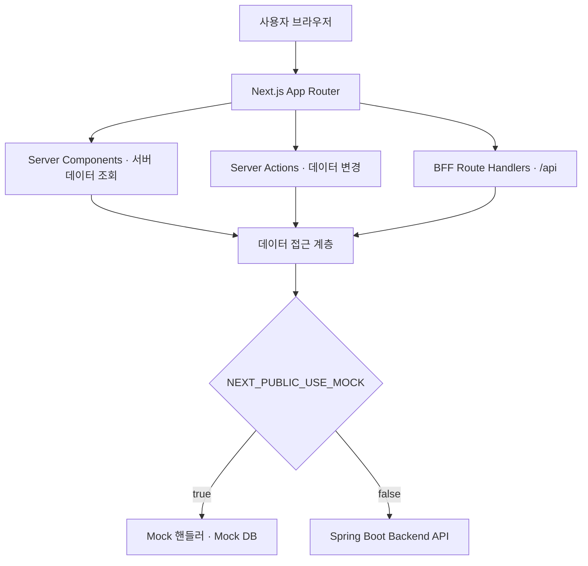

<div align="center">

# 🌱 MOA Frontend

### 함께하지 않는 시간에도, 협업은 이어지도록.

**MOA (Mind On Agile)** · AI 기반 애자일 협업 플랫폼  
**오점만점 (Five out of Five)** · Frontend Repository

<a href="https://moayo.site"></a>
<a href="https://github.com/Five-out-of-five"></a>

<br />


**[서비스 바로가기](https://moayo.site)** · **[조직 소개](https://github.com/Five-out-of-five)** · **[Backend](https://github.com/Five-out-of-five/Moa_Backend)** · **[Python AI](https://github.com/Five-out-of-five/Moa_Python)**

</div>

---

## 📌 Project Overview

**MOA**는 팀의 회의, 아이디어, 업무, 투표를 하나의 **방(워크스페이스)**에 모으고, 진행 상황을 **대시보드**에서 확인할 수 있도록 만드는 협업 서비스입니다.

이 프론트엔드 저장소는 랜딩과 인증부터 방 관리, 대시보드 위젯, 업무·투표·채팅 화면, AI 지원 UI까지 담당합니다. 자리를 비운 사이의 변경 사항과 팀의 의견을 쉽게 살펴볼 수 있도록 구성했습니다.

전체 프로젝트는 [Five out of Five 조직 페이지](https://github.com/Five-out-of-five)에서 확인할 수 있습니다.

### ✨ Key Features

| 영역 | 주요 기능 | 프론트엔드 화면 및 경험 |
|:--|:--|:--|
| 🏠 **워크스페이스** | 방 개설·참여·초대, 멤버 관리 | 방 목록, 방 관리, 초대 링크 발급과 참여 요청·승인 |
| 📊 **대시보드** | 팀에 필요한 위젯을 선택해 배치 | 12칸 그리드 및 공통 위젯 레이아웃 |
| 💡 **아이디어 보드** | 팀의 아이디어를 카드로 모아 공유 | 아이디어 카드, 댓글, 리액션 |
| 🌿 **상태값** | 팀원이 현재 상태를 공유 | 상태값 위젯 및 관련 화면 |
| ✅ **업무·스프린트** | 업무 상태와 전체 진행 상황 확인 | 업무 보드, 진척도 위젯, 스프린트 화면 |
| 🗳️ **투표** | 팀에서 결정할 안건을 올리고 의견을 모음 | 투표 위젯 및 참여 화면 |
| 📋 **캐치업 브리핑** | 자리를 비운 사이에 발생한 변경 사항을 요약해 확인 | 캐치업 브리핑 위젯 |
| 🤖 **중재** | 카드에서 발생한 충돌을 확인하고 의견을 조율 | 중재 위젯 및 AI 지원 화면 |
| 💬 **실시간 협업** | 채팅·알림 | 사이드바 채팅, 헤더 알림, 알림 설정 |
| 👤 **계정·프로필** | 개인 계정과 방별 프로필 관리 | 계정 설정, 방별 닉네임·직책·이미지 수정 |

### 🖥️ Service Preview

<div align="center">

**[🌐 배포된 MOA 서비스 살펴보기](https://moayo.site)**

</div>

<!-- 대시보드 스크린샷을 docs/screenshots/moa-dashboard.png에 추가한 뒤 아래 이미지를 표시합니다.
<p align="center">
  
</p>
-->

---

## 🛠️ Frontend Tech Stack

| 구분 | 기술 |
|:--|:--|
| **언어·프레임워크** | TypeScript 5, React 19, Next.js 15 |
| **UI·스타일링** | Tailwind CSS 4, shadcn/ui, Radix UI, Lucide |
| **라이브러리·타입** | TanStack Query, Zod, openapi-typescript |
| **개발 도구·CI** | ESLint, Prettier, Husky, GitHub Actions |

- **Next.js 15**의 App Router, Server Components, Server Actions를 사용합니다.
- **React 19**의 `useOptimistic`, `useActionState`를 사용합니다.
- **TanStack Query**, **Zod**, **openapi-typescript**는 `package.json`에 포함된 패키지 기준으로 표기했습니다. 사용 위치는 소스 코드에서 확인할 수 있습니다.

---

## 🏗️ Frontend Architecture

서버 데이터는 Server Components에서 조회하고 Server Actions로 변경합니다. 상호작용에 필요한 UI 로컬 상태는 클라이언트에서 관리합니다. `src/mocks/config.ts`의 `isMock`은 `NEXT_PUBLIC_USE_MOCK` 설정에 따라 Mock 데이터와 실제 백엔드 API를 전환합니다.



위 그림은 데이터 소스 분기를 설명하는 개념도입니다. 실제 호출 경로는 기능별 구현을 따릅니다.

| 설계 요소 | 적용 방식 |
|:--|:--|
| **App Router** | 로그인 전 `(public)`과 로그인 후 `(shell)` 영역을 구분합니다. |
| **Server Components** | 화면에 필요한 서버 데이터를 조회합니다. |
| **Server Actions** | 생성·수정·삭제(CUD)를 처리합니다. |
| **클라이언트 상태** | 상호작용에 필요한 UI 로컬 상태를 관리합니다. |
| **BFF** | `app/api/`의 Route Handlers에서 API 요청을 처리하거나 중계합니다. |
| **Mock 모드** | `isMock`에 따라 Mock 핸들러 또는 실제 백엔드 API를 사용합니다. |

---

## 🚀 Quick Start

### Requirements

- **Node.js 22 이상**
- **npm 10 이상**

### Mock 데이터로 실행

```bash
git clone https://github.com/Five-out-of-five/Moa_Frontend.git
cd Moa_Frontend
npm install
cp .env.example .env.local
npm run dev
```

Windows PowerShell에서는 `cp` 대신 다음 명령으로 환경 파일을 복사합니다.

```powershell
Copy-Item .env.example .env.local
```

`.env.local`에서 아래 값을 확인합니다. 이 설정으로 백엔드 연결 없이 Mock 데이터 기반 화면과 흐름을 확인할 수 있습니다.

```dotenv
NEXT_PUBLIC_USE_MOCK=true
```

### 실제 백엔드에 연결

`.env.local`에서 Mock 모드를 끄고 백엔드 주소를 지정합니다. 전체 환경 변수 키 목록은 [`.env.example`](./.env.example)에서 확인할 수 있습니다.

```dotenv
NEXT_PUBLIC_USE_MOCK=false
BACKEND_BASE_URL=<백엔드 주소>
```

Mock에서 지원하는 흐름과 실서버 API 연동 범위는 기능별로 다를 수 있습니다. `.env.local`은 Git에 커밋하지 않습니다.

### Commands

| 명령 | 용도 |
|:--|:--|
| `npm run dev` | 개발 서버 실행 |
| `npm run build` | 배포용 빌드 |
| `npm run start` | 프로덕션 서버 실행 |
| `npm run lint` | ESLint 검사 |
| `npm run typecheck` | TypeScript 타입 검사 |
| `npm run format` | Prettier 정리 |
| `npm run generate:api` | Swagger/OpenAPI 명세에서 TypeScript 타입 생성. 접속 가능한 명세 URL이 필요합니다. |

---

## 📁 Project Structure

```text
src/
├─ app/                   # Next.js App Router
│  ├─ (public)/           # 로그인 전
│  ├─ (shell)/            # 로그인 후 공통 셸
│  └─ api/                # BFF Route Handlers
├─ components/
│  ├─ ui/                 # shadcn/ui 기반 원소 (Button, Dialog 등)
│  ├─ common/             # 공통 블록 (Header, Sidebar 등)
│  └─ domain/             # 도메인 전용 재사용 블록
├─ features/              # room, widget, idea, task, vote, mood, briefing, mediation 등
│  └─ <도메인>/
│     ├─ actions.ts       # Server Actions (CUD)
│     ├─ server.ts        # Server Components에서 사용하는 서버 전용 조회
│     ├─ components/
│     └─ types.ts
├─ mocks/                 # Mock 데이터와 응답 생성
│  ├─ config.ts           # isMock
│  ├─ db.ts               # Mock 데이터 저장소
│  └─ <도메인>.ts          # 도메인별 Mock 핸들러
├─ lib/                   # api.ts, endpoints.ts, permission.ts, utils.ts 등
├─ hooks/
├─ types/                 # 전역 타입 (DB 스키마를 반영하는 타입 포함)
├─ constants/
└─ styles/
```

---

## 🧪 Mock 기능 테스트 가이드

<details>
<summary><strong>🏠 워크스페이스 생성 · 초대 · 승인</strong></summary>

1. 첫 번째 브라우저 세션에서 **Google Mock 계정**으로 로그인합니다. `/workspaces`에서 방을 선택하거나 새로 개설할 수 있습니다. 승인 흐름을 테스트하려면 새 방을 개설하고 초대 링크를 복사합니다.
2. 별도의 브라우저 세션에서 **Naver Mock 계정**으로 로그인합니다. `/workspaces`에서 **초대 링크로 참여하기**를 선택하고, `/invite`에서 초대 링크를 확인한 뒤 참여를 요청합니다.
3. 방장 세션으로 돌아와 `/workspaces/manage`의 **멤버** 탭에서 참여 요청을 승인합니다. **기본 설정** 탭에서는 방 정보를 관리할 수 있습니다.
4. Naver 계정 세션의 워크스페이스 목록에서 신청 결과를 확인합니다.

Mock 초대 링크와 변경 사항은 서버를 재시작하면 초기화됩니다. 실서버 방 관리 API, 소셜 로그인 복귀, 푸시 알림은 별도 백엔드 연동이 필요합니다.

</details>

<details>
<summary><strong>👤 계정 · 알림 설정</strong></summary>

- 헤더 프로필 메뉴에서 **계정 및 프로필**(`/account`)로 이동합니다. 기본 이름을 수정하고 연결 계정과 참여 중인 방을 확인할 수 있습니다.
- **알림 설정**(`/account/settings`)에서 전역 알림 수신 그룹을 저장합니다. 관리자·시스템 그룹은 항상 켜져 있습니다.
- **계정 탈퇴** 메뉴에서는 탈퇴 조건을 확인할 수 있습니다.
- Mock에서 변경한 기본 이름, 전역 알림 설정과 방 나가기 상태는 서버를 재시작하면 초기화됩니다.
- 실서버의 이름 변경, 방 나가기, 전역 알림 설정 및 실제 알림 전달은 백엔드 API 계약을 확인한 후 연결합니다.

</details>

<details>
<summary><strong>💬 방별 프로필 설정</strong></summary>

- 방에 입장한 뒤 채팅 사이드바 하단에서 **내 프로필**을 선택합니다. 닉네임·직책·이미지를 수정할 수 있습니다.
- 최초 참여 시 저장한 닉네임과 이미지를 이어서 사용하며, 변경 사항은 해당 방에만 적용됩니다.
- 업무 상세 화면에서 등록자나 담당자를 선택하면 해당 방의 멤버 프로필을 확인할 수 있습니다.
- Mock에서 저장한 변경 사항은 서버를 재시작하면 초기화됩니다.

</details>

---

## 🤝 Collaboration & Conventions

**Issue → Branch → Pull Request → Code Review → CI → Merge**

### 🌿 Branch Naming

이슈를 먼저 등록하고 발급된 번호를 브랜치명 끝에 붙입니다. 기능 개발과 UI 작업에는 `feat/`를 사용합니다.

```text
<유형>/<작업내용>#<이슈번호>
feat/<도메인>-<작업내용>#<이슈번호>
```

| 작업 유형 | 접두어 | 예시 |
|:--|:--|:--|
| 기능·UI | `feat` | `feat/auth-ui#12` |
| 버그 수정 | `fix` | `fix/vote-submit#13` |
| 리팩터링 | `refactor` | `refactor/auth-action#14` |
| 문서 | `docs` | `docs/readme-guide#15` |
| 테스트 | `test` | `test/room-permission#16` |
| 설정·인프라 | `chore` | `chore/eslint-config#17` |
| 릴리스 | `release` | `release/v1-0-0#18` |

### 📚 Team Documents

| 문서 | 내용 |
|:--|:--|
| [CLAUDE.md](./CLAUDE.md) | 프론트엔드 팀 규칙, 기술 원칙, 라우트, 권한 |
| [AGENTS.md](./AGENTS.md) | Codex용 작업 규칙. `CLAUDE.md`와 동일한 내용을 유지합니다. |
| [DECISIONS.md](./DECISIONS.md) | 팀 결정 사항, 미정 사항, 정정 이력 |

### 🔐 Sensitive File Policy

- `.env`, `*.pem`, `*.key` 등 민감 파일은 변형된 이름이나 형식을 포함해 **커밋하지 않습니다**.
- 공유가 필요한 환경 변수는 `.env.example`에 **값 없는 키 목록**으로 남깁니다.
- `.gitignore`는 프로젝트 첫 커밋부터 적용해 민감 파일의 추적을 차단합니다.

---

## 👥 Frontend Team

<table align="center">
  <tr>
    <td align="center" width="260">
      <a href="https://github.com/jia40">
        
        <br /><strong>이주은</strong>
      </a><br />
      <sub>FE-1 · 인증 · 방 · 대시보드 · 아이디어 · AI</sub><br />
      <a href="https://github.com/jia40">@jia40</a>
    </td>
    <td align="center" width="260">
      <a href="https://github.com/zana0422-creator">
        
        <br /><strong>이홍근</strong>
      </a><br />
      <sub>FE-2 · 업무 · 투표 · 채팅 · 운영</sub><br />
      <a href="https://github.com/zana0422-creator">@zana0422-creator</a>
    </td>
  </tr>
</table>

| 담당 | 주요 작업 |
|:--|:--|
| **이주은 (FE-1)** | 랜딩·인증, 계정 설정·방별 프로필, 워크스페이스, 12칸 그리드와 위젯 공통 레이아웃, 상태값·아이디어·브리핑·중재 위젯, AI 화면 |
| **이홍근 (FE-2)** | 업무 보드·진척도·스프린트, 투표 위젯, 사이드바 채팅, 알림, Slack·Notion 연동 설정, 관리자 페이지 |

---

## 🔗 Related Repositories

| 저장소 | 역할 |
|:--|:--|
| [Moa_Frontend](https://github.com/Five-out-of-five/Moa_Frontend) | Next.js 기반 웹 UI, 협업 대시보드 |
| [Moa_Backend](https://github.com/Five-out-of-five/Moa_Backend) | Spring Boot API, 인증·도메인 로직, 실시간 통신 |
| [Moa_Python](https://github.com/Five-out-of-five/Moa_Python) | Python AI 서버 및 협업 지원 기능 |

---

<div align="center">

### 🌱 Five out of Five

**작은 의견도 놓치지 않고, 함께 더 나은 협업을 만듭니다.**

[**🌐 Live Demo**](https://moayo.site) · [**🏠 Organization**](https://github.com/Five-out-of-five)

</div>